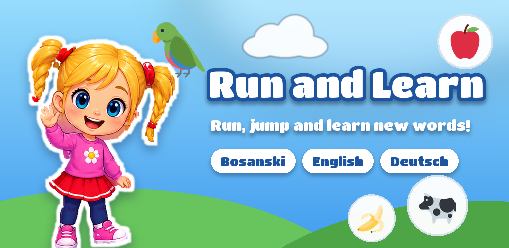
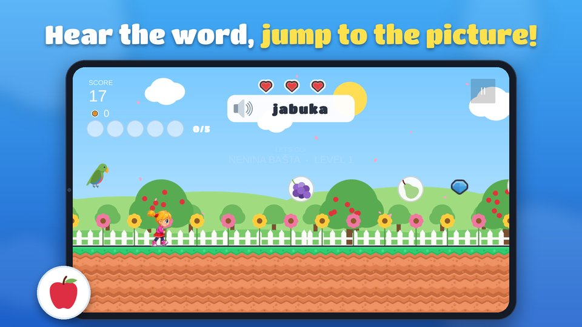
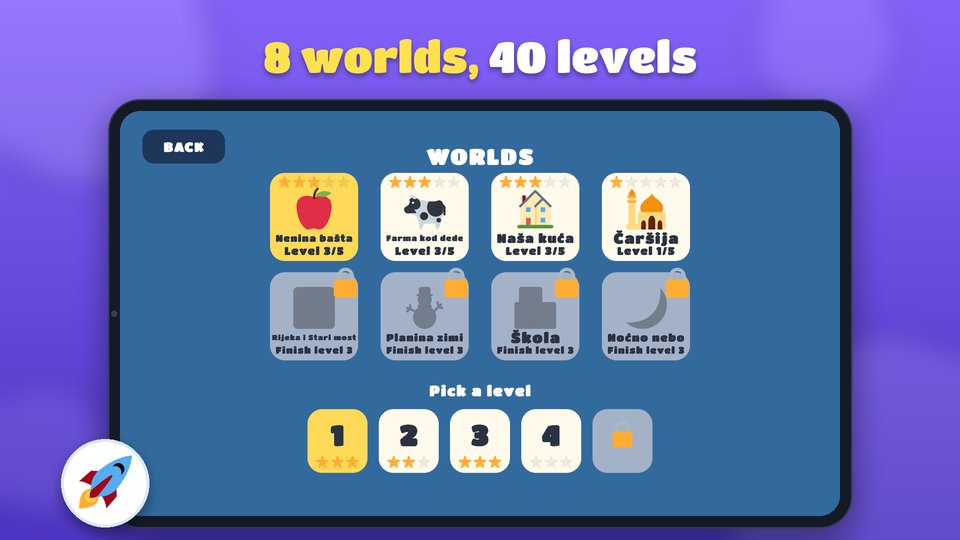
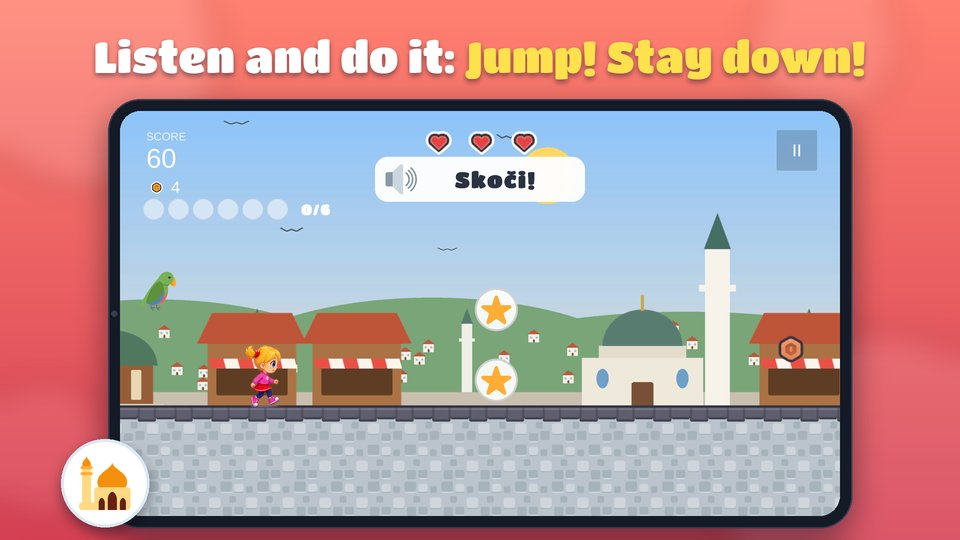
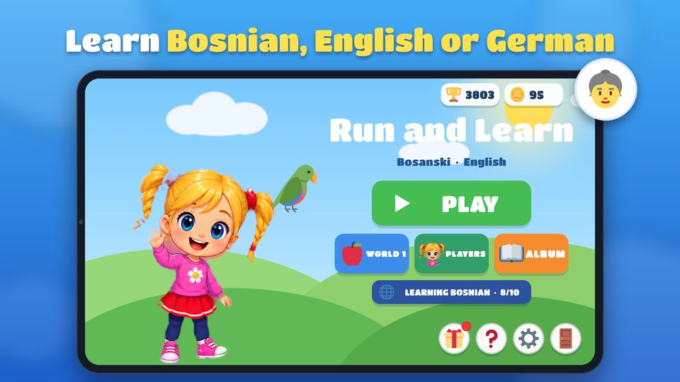

# Run and Learn

A gentle endless runner for children aged 4 to 10 that teaches Bosnian, English or German words.
A voice says a word, picture bubbles float ahead, and the child jumps into the right one.



| | |
|---|---|
|  |  |
|  |  |

**Status:** in closed testing on Google Play (package `com.rukajja.runlearn`, developer Rukajja Games).

## Features

- **Three languages, two directions.** Children abroad learn Bosnian with English or German menus;
  children in Bosnia and Herzegovina learn English or German.
- **8 worlds, 40 levels** with a difficulty curve: each level is a little faster and asks a little more.
- **Different kinds of learning:** catch the word, counting (1–5, 1–10), listen-and-do commands
  ("Jump! Stay down!"), big or small, short sentences, letters and first reading, and a final review world.
- **Spaced repetition:** words a child misses come back more often; stars track words the child really knows.
- **No punishment for mistakes:** the right picture lights up and the word is repeated.
- **Motivation without pressure:** daily gift, three daily tasks, coins, thirteen players to unlock,
  a sticker album of learned words, and Pepi the parrot as a companion.
- **Family friendly:** no ads, no data collection, works offline, no `INTERNET` permission.

## Tech

- **Unity 6** (6000.3.1f1), C#, 2D URP, new Input System. Target Android 7.1+ (API 25), target SDK 36, arm64.
- About **15,000 lines of C#** in 67 scripts, organised by area: `Core`, `Gameplay`, `Player`, `Learning`,
  `Adventure`, `UI`, `SaveSystem`, `Audio`, `Effects`.
- **~80 automated PlayMode tests** (Unity Test Framework) covering the game loop, level progression,
  word challenges, daily rewards, the album, German support and each world.
- **Data-driven content:** word packs per world are JSON (`Assets/Resources/Words/World*/pack.json`),
  generated by `Tools/generate_words.py`.
- **Python tooling** (Pillow) for art and store assets: characters drawn in code (`make_characters.py`),
  world and menu art, app icon, and Play Store screenshots composed from captures taken by PlayMode tests.
- **Release pipeline:** command-line Android build (`Assets/Editor/CommandLineBuild.cs`) that reads signing
  credentials from a folder outside the repository, so no passwords live in the project.

## Project layout

```
Assets/Scripts/      game code (one assembly: FootballRunner.asmdef)
Assets/Tests/        PlayMode tests and screenshot capture
Assets/Resources/    word packs, pictures, fonts, menu art
Tools/               Python generators for words, art and store assets
Store/               Play listing texts (en, bs, de), privacy policy, store art
```

## Credits

- Pictures: [Twemoji](https://github.com/twitter/twemoji) by Twitter, Inc. and contributors, CC BY 4.0.
- Environment art: Sunny Land by Ansimuz. Its license does not allow redistributing the source files,
  so `Assets/ThirdParty/` is not in this repository. To open the project in Unity, get the Sunny Land pack
  from its author and import it into `Assets/ThirdParty/Ansimuz/SunnyLand/`; without it, scenes show
  missing sprites but the code and tests are complete.
- Font: Titan One (SIL Open Font License).
- Rukajja character art was created with the help of AI image tools; the other kids are drawn in code.

Made by Adnan Hodžić.
